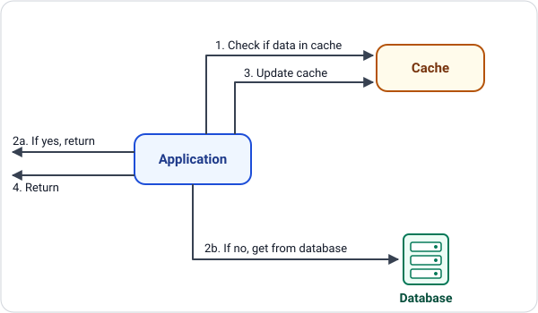
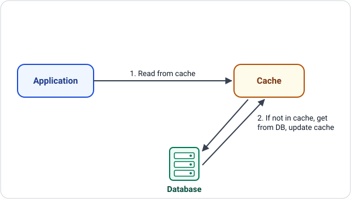
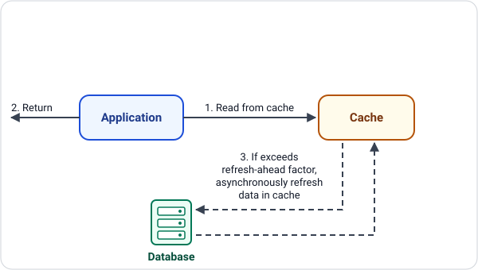
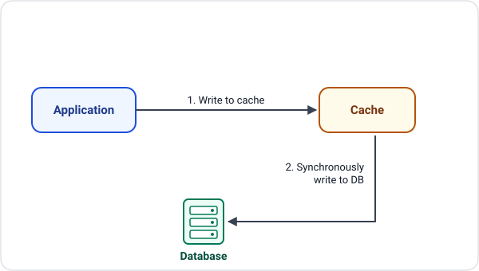
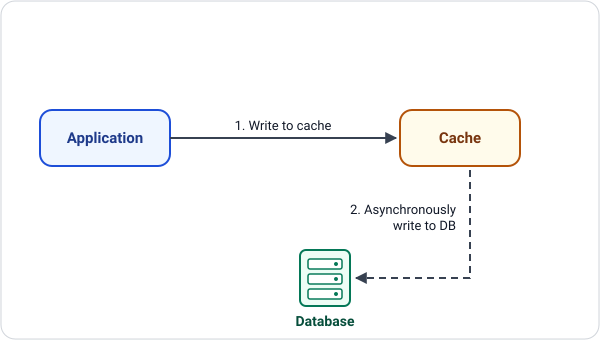
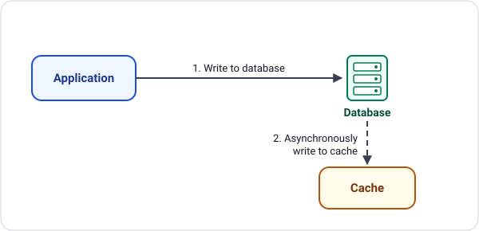

# cache-me
cache-me

## Documentation

| Document | Description |
|----------|-------------|
| [Creating projects with the .NET CLI](documentation/dotnet-cli.md) | Create solutions, class libraries, test projects, references and packages; build and run tests |
| [Common Caching Strategies](caching-strategies.md) ([HTML version](caching-strategies.html)) | Cache-aside, read-through, refresh-ahead, write-through, write-behind and write-around, with SVG diagrams |

# Common Caching Strategies

A cache keeps copies of frequently used data close to the application so that most requests never need to hit the (slower) database. *How* data moves between the application, the cache and the database is the caching strategy. The six strategies below cover the common read patterns (cache-aside, read-through, refresh-ahead) and write patterns (write-through, write-behind, write-around).

> Solid arrow: synchronous call. Dashed arrow: asynchronous (background) call. Step labels in the diagrams match the numbered steps in the text.

## Contents

- [Cache-aside](#cache-aside) (read strategy)
- [Read-through](#read-through) (read strategy)
- [Refresh-ahead](#refresh-ahead) (read strategy)
- [Write-through](#write-through) (write strategy)
- [Write-behind](#write-behind) (write strategy)
- [Write-around](#write-around) (write strategy)
- [Comparison](#comparison)
- [Combining strategies](#combining-strategies)

## Cache-aside

*Read strategy, also known as: Lazy loading*

The application owns the caching logic. It looks in the cache first, and only on a miss does it go to the database, copy the result into the cache and return it. Only data that is actually requested ever gets cached.

**How it works**

- **1.** The application checks the cache for the requested key.
- **2a.** Cache hit: the value is found, so the application returns it straight away. The database is never touched.
- **2b.** Cache miss: the application queries the database for the data.
- **3.** The application stores the result in the cache (usually with a TTL) so the next request is a hit.
- **4.** The application returns the data to the caller.

**Advantages**

- Only requested data is cached, so memory is not wasted.
- Resilient: if the cache is down, the application can still read from the database.
- Simple, widely understood, and works with any cache.

**Trade-offs**

- The first request for a key always pays the cache-miss penalty.
- Data can go stale if the database changes and the entry is not invalidated or expired.
- Caching logic lives in application code and must be repeated wherever it is needed.

**Best for:** Read-heavy workloads where some staleness is acceptable, such as product catalogues, user profiles and reference data.

## Read-through

*Read strategy, also known as: Cache as the data gateway*

The application talks only to the cache. When the data is missing, the cache itself loads it from the database, stores it and returns it, so the loading logic is hidden from the application.

**How it works**

- **1.** The application always reads from the cache, never directly from the database.
- **2.** On a miss, the cache fetches the data from the database and updates itself. Either way, the cache then returns the data to the application.

**Advantages**

- Application code is simpler: one read call, no miss-handling branch.
- Loading logic is defined once, in the cache layer, so behaviour is consistent.
- Pairs naturally with write-through for consistent reads and writes.

**Trade-offs**

- Needs a cache provider or library that supports loaders.
- The first read of a key is still slow.
- The cache becomes a critical dependency: if it fails, reads fail.

**Best for:** Read-heavy systems using a cache platform with built-in loaders (for example NCache, Hazelcast, Ehcache or Oracle Coherence), where you want data access hidden behind a single interface.

## Refresh-ahead

*Read strategy, also known as: Prefetch*

The cache predicts which entries will be needed again and reloads them in the background before they expire. Frequently used data stays warm, so readers rarely see a miss or a slow reload.

**How it works**

- **1.** The application reads the key from the cache.
- **2.** The cache returns the current value immediately, with no waiting.
- **3.** If the entry's age has passed the refresh-ahead factor (for example 75% of its TTL), the cache asynchronously reloads it from the database and replaces the cached value.

**Advantages**

- Very low read latency for hot keys.
- Avoids the latency spike and stampede that happen when a popular entry expires.
- Refreshing happens off the request path.

**Trade-offs**

- More complex: needs access tracking and a tuned refresh-ahead factor.
- Wasted database load if the prediction is wrong and the entry is never read again.
- Data can still be stale between refreshes.

**Best for:** Hot data with predictable access patterns, such as leaderboards, exchange rates, feature flags and dashboard summaries.

## Write-through

*Write strategy, also known as: Synchronous write*

Every write goes to the cache and is written to the database in the same operation. The write only completes once both have the data, so the cache and the database never disagree.

**How it works**

- **1.** The application writes the data to the cache.
- **2.** The cache synchronously writes the same data to the database. Only after this succeeds is the write acknowledged to the application.

**Advantages**

- Cache and database stay consistent.
- Reads straight after a write are cache hits, with no stale values.
- Data is durable as soon as the write returns.

**Trade-offs**

- Higher write latency, because every write waits for two stores.
- Data that is written but rarely read still occupies cache memory.
- A database failure fails the write and must be handled by the cache layer.

**Best for:** Systems that need read-after-write consistency, such as account settings, inventory counts and financial records. Commonly paired with read-through.

## Write-behind

*Write strategy, also known as: Write-back*

The application writes only to the cache, which acknowledges at once. The cache then updates the database later, in the background, often batching or coalescing several writes into one.

**How it works**

- **1.** The application writes the data to the cache and gets an immediate acknowledgement.
- **2.** The cache asynchronously writes the data to the database, typically in batches after a short delay.

**Advantages**

- Lowest write latency of the write strategies.
- Batching and coalescing reduce the number of database writes and absorb traffic spikes.
- The application is shielded from slow or briefly unavailable databases.

**Trade-offs**

- Risk of data loss if the cache fails before the data is flushed.
- The database is only eventually consistent with the cache.
- Needs careful handling of write ordering, retries and failures.

**Best for:** Write-heavy workloads that can tolerate a small loss window, such as counters, activity feeds, analytics events and session data.

## Write-around

*Write strategy, also known as: Bypass cache on write*

Writes go directly to the database and skip the cache, so data that is written once and rarely read does not push useful entries out. The cache is brought up to date afterwards, or on the next read.

**How it works**

- **1.** The application writes the data directly to the database, bypassing the cache.
- **2.** The cache is updated asynchronously afterwards (or is populated on the next read miss), so it catches up with what was written.

**Advantages**

- Avoids cache pollution from data that is never read back.
- The database is the source of truth immediately after the write.
- Write path stays simple and fast.

**Trade-offs**

- Reading recently written data is likely to be a cache miss.
- Existing cache entries for the key are stale until they are updated or invalidated.

**Best for:** Write-once, read-rarely data, such as logs, audit trails, bulk imports and archives.

## Comparison

| Strategy | Type | Who talks to the database | Best for | Main trade-off |
|----------|------|---------------------------|----------|----------------|
| Cache-aside | Read | Application | Read-heavy, general purpose | Cold-miss latency; possible stale data |
| Read-through | Read | Cache (on a miss) | Read-heavy, cache with loader support | Cache is on the critical path |
| Refresh-ahead | Read | Cache (in the background) | Hot, predictable keys | Wasted refreshes if prediction is wrong |
| Write-through | Write | Cache (synchronously) | Read-after-write consistency | Slower writes |
| Write-behind | Write | Cache (asynchronously) | Write-heavy, loss-tolerant data | Data loss if the cache fails |
| Write-around | Write | Application (directly) | Write-once, read-rarely data | Misses on recently written data |

## Combining strategies

In practice a read strategy and a write strategy are used together:

- **Read-through + write-through**: all reads and writes go through the cache, keeping both consistent.
- **Cache-aside + write-around**: the application reads lazily and writes straight to the database, invalidating or updating the cache entry as needed.
- **Read-through + write-behind**: fastest option for read- and write-heavy data, at the cost of a possible loss window.
- **Refresh-ahead on top of any read strategy**: keeps the hottest keys warm.

---
