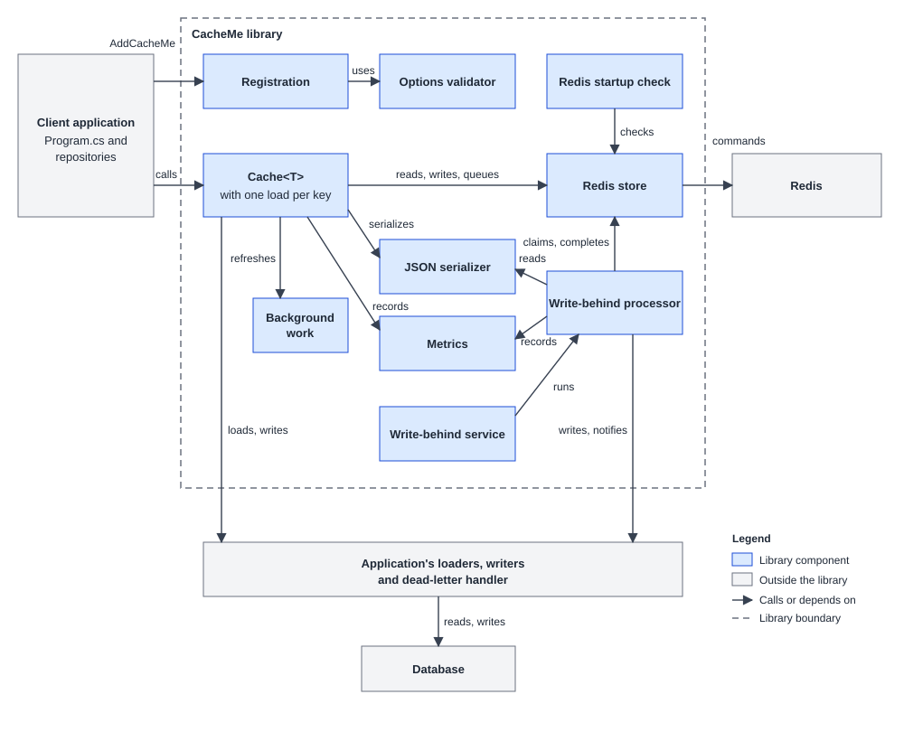

# Library Component Design

| Field       | Value                                                                                                              |
|-------------|--------------------------------------------------------------------------------------------------------------------|
| Stage       | 4 – Component design                                                                                               |
| Version     | v1                                                                                                                 |
| Date        | 2026-11-01                                                                                                         |
| Status      | Awaiting answers                                                                                                   |
| Approved on | —                                                                                                                  |
| Based on    | analysis-v3.md (Approved), configuration-v4.md (Approved), api-methods-v2.md (Approved), test-plan-v1.md (Approved) |
| Supersedes  | —                                                                                                                  |

## Changelog
- v1: First version. Designs the internal structure of the library as the blueprint for Stage 5.

## Component diagram

This design assumes the suggested answers to the open questions.

## Components
| Name | Responsibility | Public / internal | Depends on | Requirements |
|------|----------------|-------------------|------------|--------------|
| Registration | Turns `AddCacheMe`, `ForType` and the `Use...` calls into DI registrations, and rejects invalid registrations immediately. | public | Options validator | FR-001, FR-002, FR-003, FR-008, FR-036, TD-004, TD-006 |
| Options validator | Checks every setting and reports all failures together when the application starts. | internal | Policy registry | FR-009, FR-022, FR-025, FR-026, FR-028, FR-029, FR-033, FR-034, FR-038, NFR-002, NFR-003, TD-011 |
| `Cache<T>` | Runs each `ICache<T>` operation according to the type's policy, and turns failures into result objects. | public | Redis store, JSON serializer, Background work, Metrics, loaders and writers | FR-003 to FR-021, FR-029 to FR-034, FR-037, FR-038, TD-005, TD-007 |
| JSON serializer | Turns values into bytes and back, unless the application replaces it. | internal | — | FR-016, FR-035 |
| Redis store | Implements `IWriteBehindStore` on Redis, including the queue and the dead-letter store. | internal | Redis | FR-020, FR-022 to FR-027, FR-029, FR-032, FR-036, NFR-003, NFR-006, NFR-007, TD-009 |
| Background work | Runs refreshes off the request path and cancels them at shutdown. | internal | — | FR-008 |
| Write-behind processor | Claims due writes, calls the writer, and handles retries and dead letters. | internal | Redis store, JSON serializer, Metrics, writers, dead-letter handler | FR-020, FR-022 to FR-028, NFR-006, NFR-008 |
| Write-behind service | Hosted service that runs the processor on a loop and flushes at shutdown. | internal | Write-behind processor | FR-020, FR-022, FR-028 |
| Redis startup check | Logs warnings at startup if Redis cannot be reached, or if its settings are unsafe for the queue. | internal | Redis store | FR-012, NFR-007 |
| Metrics | Publishes hit, miss, error and queue depth metrics. | internal | — | NFR-008, TD-008 |

## Main flows

### `GetAsync` with cache-aside
1. `Cache<T>` validates the key, checks the policy has a read strategy, and adds the prefix.
2. The Redis store reads the entry. If the store fails, `Cache<T>` returns `Failed` with `StoreUnavailable`.
3. On a hit, the JSON serializer reads the value, Metrics records a hit, and `Cache<T>` returns `Found`.
4. On a miss or an unreadable entry, Metrics records a miss and `Cache<T>` returns `NotFound`. An unreadable entry also logs a warning.

### `GetAsync` with read-through
1. Steps 1 to 3 above, except that a store failure logs a warning and continues as a miss.
2. On a miss, `Cache<T>` joins the load for that key, or starts one if none is running (FR-015).
3. The load creates a new DI scope and calls the loader with the key without its prefix.
4. If the loader returns null, the result is `NotFound`, and nothing is cached.
5. If the loader throws, the result is `Failed` with `LoaderFailed`, with no retry.
6. Otherwise, `Cache<T>` stores the value with the effective default TTL and returns `Found`. If storing fails, it logs a warning and still returns `Found`.

The load does not use a caller's token. A caller who cancels stops waiting, and the load is cancelled only when no callers are left (TD-005).

### `GetAsync` with refresh-ahead
1. On a hit, `Cache<T>` compares the entry's age with the effective threshold. Age is measured from `CreatedAt` using `TimeProvider`.
2. If the age is past the threshold, the key has no queued write, and no refresh is running for the key, `Cache<T>` hands a refresh to Background work.
3. `Cache<T>` returns the current value immediately.
4. In the background, the refresh creates a new DI scope, calls the loader and stores the result. If the loader fails, it logs a warning, and the current value stays until its TTL ends. A later read can try again (FR-011).

### `StoreInCacheAsync`
1. `Cache<T>` validates the input and checks the read strategy is cache-aside.
2. The JSON serializer produces the bytes, and `Cache<T>` checks them against `MaxValueBytes`.
3. The Redis store saves the entry with its TTL. The write strategy is not involved (FR-006).

### `WriteAsync` with write-through
1. `Cache<T>` validates the input and checks the policy has a write strategy.
2. The JSON serializer produces the bytes, and `Cache<T>` checks the size, before the database is touched.
3. In a new DI scope, the writer saves the value. If it throws, the result is `WriterFailed`, and the cache is unchanged (FR-018).
4. The Redis store saves the entry. If that fails, `Cache<T>` logs a warning, tries to remove the old entry, and still reports success (FR-019).

### `WriteAsync` with write-behind
1. `Cache<T>` validates the input and checks that the write-behind service is running.
2. The JSON serializer produces the bytes, and `Cache<T>` checks the size.
3. `TryEnqueueAsync` stores the value with no expiry and queues the write, in one atomic step. It replaces any value already queued for the key (FR-023, FR-027).
4. `Cache<T>` reports success, or `QueueFull` or `StoreUnavailable`.

### `WriteAsync` with write-around
1. `Cache<T>` validates the input. It does not serialize the value, because the value does not go to the cache.
2. In a new DI scope, the writer saves the value. If it throws, the result is `WriterFailed`, and the entry stays.
3. The Redis store removes the entry. If that fails, `Cache<T>` logs a warning and still reports success (FR-031).

### `RemoveAsync`
1. `Cache<T>` validates the key.
2. If the store supports write-behind, `CancelAsync` removes any queued write first, so it cannot bring the row back (FR-032).
3. The Redis store removes the entry. A failure in either step returns `StoreUnavailable`.

### Flushing queued writes
1. The write-behind service calls `FlushOnceAsync` every 250 ms, and again at once whenever a flush found work.
2. The processor reads the queue length, which also updates the queue depth metric. If a full batch is waiting, it claims writes of any age; otherwise only those older than `MaxFlushDelay` (FR-022).
3. For each claimed write, up to 8 at a time (Q-002), the processor finds the policy by `ValueType`, deserializes the value and creates a new DI scope.
4. The writer saves the value, using the key without its prefix. `CompleteAsync` then removes the write and applies its TTL to the entry, unless a newer write has replaced it.

### A queued write fails
1. The processor records `WriterFailed` and works out the tries so far.
2. If tries remain, `RetryLaterAsync` schedules the next one after `InitialDelay` × 2^(tries failed before this one), capped at `MaxDelay`.
3. Otherwise, `MoveToDeadLetterAsync` stores it for `Retention`, an error is logged, and the handler (if any) is called in a new DI scope. A handler failure is logged, and the write stays stored (FR-026).
4. A write whose value cannot be read, or whose type is no longer registered, goes straight to step 3.

### Application start and stop
1. **Start:** Options validation runs through `ValidateOnStart`. The Redis startup check pings Redis and, if a type uses write-behind, reads `INFO`. Both only log warnings, so the application always starts (FR-012, NFR-007).
2. **Stop:** the write-behind service marks itself as not running, so new write-behind writes throw. It stops the loop, then calls `FlushAllAsync`, which claims writes of any age until none are left or `ShutdownTimeout` passes (FR-028).

## Redis data layout

Each of these keys starts with the configured `KeyPrefix`, so applications sharing a Redis do not share a queue. The library reserves the `__cacheme:` part of the key space.

| Key | Redis type | Holds | Requirement |
|-----|------------|-------|-------------|
| `<prefix><key>` | String | The entry: a marker byte, a format version, `CreatedAt`, the TTL, then the value. A value that fails this check counts as unreadable. Has a Redis expiry, except while a write is queued. | FR-016, FR-027, FR-034 |
| `<prefix>__cacheme:writes` | Hash | One record per queued key: value, value type, TTL, first queued time, attempts, version. Its length is the queue length. | FR-023, FR-029 |
| `<prefix>__cacheme:new` | Sorted set | Keys waiting for their first try, scored by queued time. | FR-022 |
| `<prefix>__cacheme:held` | Sorted set | Keys that are claimed or waiting to retry, scored by when they next become available. | FR-025, NFR-007 |
| `<prefix>__cacheme:dead:index` | Sorted set | Dead-letter IDs, scored by failed time, for listing oldest first. | FR-026 |
| `<prefix>__cacheme:dead:<id>` | String | One dead-letter write, which Redis expires after `Retention`. | FR-026 |

**Atomic steps.** `TryEnqueueAsync`, `ClaimAsync`, `CompleteAsync`, `RetryLaterAsync`, `MoveToDeadLetterAsync`, `CancelAsync` and `GetAsync` (which also checks the queue, for `HasQueuedWrite`) each run as one Lua script. Lua scripts can touch several keys in one step because Stage 0 supports only a single Redis endpoint (Q-010 in Stage 0).

**One claim per key.** A write arriving while its key is claimed replaces the record with a new version and resets its attempts, but the key stays in `held`. `CompleteAsync` sees the version has changed and moves the key to `new`, so the newer value is written after the older one finishes (FR-024).

**Fills cannot overwrite a queued value.** `SetAsync` does nothing if the key has a queued write, so a slow refresh or load cannot replace a newer value or put an expiry back on it (FR-010, FR-027).

**Dead-letter IDs.** The `Id` of a dead-letter write is its `QueuedWrite.Version`, a GUID created when the write is queued. `MoveToDeadLetterAsync` returns no value, so this is how the processor and the store agree on the ID without changing the API.

**Timeouts.** The store applies `OperationTimeout` to every operation with `Task.WaitAsync`, including waiting for a connection, so it also works with a supplied `IConnectionMultiplexer`. A connection it creates itself sets `AbortOnConnectFail` to false, and connects on first use (NFR-003, FR-012).

## Component to code mapping

All types use the root namespace `CacheMe` (TD-001). Files marked "new" do not exist yet.

| Component | Classes | Namespace | Folder |
|-----------|---------|-----------|--------|
| Registration | `CacheMeServiceCollectionExtensions`, `CacheMeBuilder`, `CachePolicyBuilder<T>` | `CacheMe` | `src/CacheMe` |
| Policy data, used by Registration, `Cache<T>` and the processor | `CachePolicy<T>`, `CachePolicyRegistry` | `CacheMe` | `src/CacheMe/Internal` |
| Options validator | `CacheMeOptionsValidator` (new) | `CacheMe` | `src/CacheMe/Internal` |
| `Cache<T>` | `Cache<T>`, `KeyedLoader<T>` (new, one load per key) | `CacheMe` | `src/CacheMe`, `src/CacheMe/Internal` |
| JSON serializer | `JsonCacheSerializer` (new) | `CacheMe` | `src/CacheMe/Internal` |
| Redis store | `RedisCacheStore` (new), `RedisCacheEntryFormat` (new), `RedisScripts` (new) | `CacheMe` | `src/CacheMe/Internal/Redis` |
| Background work | `BackgroundWork` (new), implementing `IBackgroundWork` | `CacheMe` | `src/CacheMe/Internal` |
| Write-behind processor | `WriteBehindProcessor` | `CacheMe` | `src/CacheMe/Internal` |
| Write-behind service | `WriteBehindService` (new), implementing `IWriteBehindStatus` | `CacheMe` | `src/CacheMe/Internal` |
| Redis startup check | `RedisStartupCheck` (new) | `CacheMe` | `src/CacheMe/Internal/Redis` |
| Metrics | `CacheMetrics` (new), implementing `ICacheMetrics` | `CacheMe` | `src/CacheMe/Internal` |
| Models and options | Unchanged from Stage 2 | `CacheMe` | `src/CacheMe/Models`, `src/CacheMe/Options` |

## Cross-cutting concerns
- **Configuration (TD-004):** settings bind from JSON with `ErrorOnUnknownConfiguration`, then code runs on top. `CacheMeOptionsValidator` runs through `ValidateOnStart`. Components read `IOptions<CacheMeOptions>`, and effective per-type values are worked out when needed. Settings do not change while the application runs.
- **Logging (TD-008):** `Cache<T>`, the processor, the store and the startup check use `ILogger<T>`. Handled failures log at Warning, and dead letters log at Error. Keys appear at Debug level only. Connection strings and values are never logged (TD-011).
- **Errors (TD-007):** `Cache<T>` catches exceptions from the store, serializer, loader and writer and turns them into result objects. Only programmer errors, invalid registrations and invalid settings throw. An `OperationCanceledException` is rethrown only if the caller's own token was cancelled; otherwise, it counts as a failure of that dependency.
- **Threading (TD-005, TD-006):** `Cache<T>` and the store are singletons with no per-request state. `KeyedLoader<T>` and the refresh guard use `ConcurrentDictionary`. Loaders and writers get a new scope per use, so they never share a `DbContext`. The library does not use `ConfigureAwait(true)` or sync-over-async anywhere.
- **Metrics (TD-008):** `CacheMetrics` uses a `Meter` named `CacheMe`. The queue depth gauge reports the last value read by the processor, so it is only as fresh as the last flush.

## Assumptions

These are design choices for you to correct if they are wrong:

- **One small internal addition to the Stage 2 shape:** `ICacheMetrics` gains `RecordQueueDepth(long)`, because the gauge needs a value and the approved interface has no way to supply it. It is internal, so the public API and the tests are unaffected.
- **New package:** `Microsoft.Extensions.Hosting.Abstractions`, for the hosted services, as noted at the end of Stage 2.
- **Claims last 5 minutes, as a fixed value.** A write whose writer runs longer than that can be claimed again and run twice. Stage 1 approved no setting for this, so I have not added one.
- **The flush loop polls every 250 ms,** as a fixed value. This is about 8 small Redis commands per second per instance, and only for applications using write-behind. A full batch can therefore wait up to 250 ms.
- **Persistence check:** the startup check warns if AOF persistence is off or if `maxmemory-policy` is an `allkeys-*` policy. It uses `INFO`, which does not need admin rights. `volatile-*` policies are safe, because queue keys have no expiry.
- **Custom stores:** anyone implementing `IWriteBehindStore` must follow the same rules as the Redis store: `SetAsync` must not overwrite a queued value, and `Id` must equal `QueuedWrite.Version`. Stage 5 adds this to the XML docs.

## Open Questions

### Q-001 [Important] A write-behind write can run twice
**Why it matters:** the processor calls the writer, then marks the write complete. If an instance crashes between those two steps, the claim expires and another instance runs the write again. Reversing the order avoids repeats, but then a crash loses the write, which NFR-007 rules out. No order gives exactly-once delivery across Redis and a database.
**Options:** a) At-least-once: a write can run twice after a crash; the consumer README tells you to make writers safe to repeat  b) At-most-once: mark complete first, and accept losing a write in a crash (this changes NFR-007)
**Suggested:** a — saving the same value twice is usually harmless, because a writer stores a whole value, not a change. Be careful with writers that insert rows or add to a total.
**Answer:**
>

### Q-002 [Important] How many writes a flush runs at once
**Why it matters:** this limits write-behind throughput. One at a time, with 10 ms per database write, is about 100 writes per second per instance, which is below the 1,000 operations per second in NFR-001, so the queue could keep growing under sustained load. Running several at once uses more database connections. Order per key is safe either way, because a key is only claimed once at a time.
**Options:** a) One at a time  b) Up to 8 at once, as a fixed value  c) Up to 8 at once by default, with a new setting (this changes Stage 1)
**Suggested:** b — it gives about 800 writes per second per instance at 10 ms per write, with no new setting. Choose c if you expect to need tuning.
**Answer:**
>

## Decisions

None yet.
